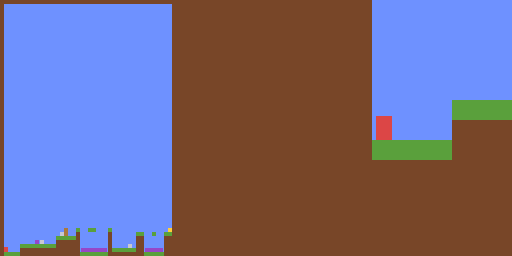

# procgen-jax

[OpenAI ProcGen](https://github.com/openai/procgen) reimplemented in **pure JAX**.

ProcGen ships as a C++ extension driven from Python: every `step()` crosses the
Python/C++ boundary, and no part of the environment can be `jit`ed. Here the level
generator, the game rules and the observation renderer are all `jax.numpy` / `lax`
code, so an entire vectorised rollout becomes a single `lax.scan` — no host↔device
synchronisation per step, and `jax.vmap` turnaround for free.

## Status

| Game       | Rules ported | Notes                                                      |
| ---------- | ------------ | ---------------------------------------------------------- |
| `maze`     | ✅            | Kruskal mazes, grid movement, goal reward                   |
| `coinrun`  | ✅            | platformer physics, hazards, coin; levels match the C++ 1:1  |

The remaining 14 games are planned; see the roadmap below. Each game in the
original is only 121-523 lines of logic on top of a shared engine, so the
incremental cost per game is small now that `procgen_jax/engine.py` exists.

## Demo

One episode of each game, recorded with `pixi run video docs` (160 frames at 20 fps,
one jitted `lax.scan`, frames piped straight to `ffmpeg`):

| `maze` -- shortest path to the goal | `coinrun` -- whole level, then the agent's view |
| :---------------------------------: | :---------------------------------------------: |
|  |  |

The left half of the `coinrun` recording is the whole 64x64 level, drawn from the same
sprite atlas as the game; the right half is the 64x64 observation the agent actually
receives -- an agent-centred 13 tile window (`visibility = 13`), about five pixels per
tile. The policy only walks right and jumps over walls and ledges, which is enough to
reach the coin.

## Playing it yourself

```bash
pixi run webplay                 # browser window: open http://127.0.0.1:8010
pixi run play                    # the same game in the terminal
pixi run play -- --game maze     # the other game
pixi run play -- --seed 42       # a specific level (the C++ implementation's seed 42)
pixi run play -- --eager         # literally no jax.jit
```

`webplay` is the one to use if you want to look at the picture: it serves a page whose
canvas shows the 64x64 observation scaled up with nearest-neighbour, so what you see is
exactly what the agent receives. Frames go over localhost as raw RGB, so there is no
image encoder and no extra dependency. `pixi run webplay -- --seed 42` pins a level and
`/?seed=42` does the same from the address bar.

Keys: `a`/`d` or the arrows move, `w`/`up`/space jumps, `s` stands still, `p` pauses,
`.` advances exactly one frame, `n`/`m` change the seed, `r` restarts, `q` quits.

The observation is drawn with 24-bit colour half blocks, so 64x64 pixels fit in a
64x32 character grid; `--ascii` falls back to a brightness ramp and
`--record runs/me.gif` saves the frames you played, so a session can be compared
against a ProcGen recording side by side.

`--eager` really does skip `jax.jit`, but an uncompiled step dispatches thousands of
primitives (one per corner sample, per sub-step, per entity), so expect about a second
per frame -- usable for stepping through with `.`, not for playing. The default
compiles `step` once at start-up and then runs at 20 fps; rendering is always eager.

## Install

```bash
pixi install          # CPU JAX
pixi install -e gpu   # CUDA 12 JAX
```

## Usage

```python
import jax
from procgen_jax import MazeEnv

env = MazeEnv(world_dim=15)  # 15 = ProcGen's "easy" maze
state = env.reset(jax.random.PRNGKey(0))

for _ in range(500):
    action = jax.random.randint(jax.random.PRNGKey(1), (), 0, 9)
    state = env.step(state, action)  # state.obs is (64, 64, 3) uint8
    print(float(state.reward), bool(state.done), state.info['terminated'])
```

Vectorised, and fully jit-able:

```python
import jax
from procgen_jax import MazeEnv

env = MazeEnv(world_dim=15)


@jax.jit
def rollout(keys):
    state = jax.vmap(env.reset)(keys)  # (B, ...) pytree
    actions = jax.random.randint(keys[0], (128, keys.shape[0]), 0, 9)

    def body(carry, action):
        state = jax.vmap(env.step)(carry, action)
        return state, state.reward

    states, rewards = jax.lax.scan(body, state, actions)
    return states.obs, rewards


observations, rewards = rollout(jax.random.split(jax.random.PRNGKey(0), 64))
```

Run the bundled demo (random policy, prints throughput):

```bash
pixi run demo
```

Record a video:

```bash
pixi run video        # writes runs/maze.gif and runs/coinrun.gif
```

`procgen_jax/recording.py` collects the frames with one `lax.scan` (the observation
lives in the state, so an episode is a `(T, 64, 64, 3)` array with no per-step host
round-trip) and pipes them to `ffmpeg` as raw RGB -- no Python imaging dependency.
Recording is deliberately *not* a `Wrapper`: a wrapper that accumulated frames would
either grow a pytree leaf every step, which breaks `scan`'s static carry, or call
back into the host, which breaks `jit`.

## Environment API

The interface follows Brax's `Env`/`State` design rather than a gym-style
`(obs, reward, done, info)` tuple: the observation lives *inside* the state, so a
rollout is a pure `lax.scan` over pytrees with no per-step host round-trip.

| Method                    | Returns                          |
| ------------------------- | -------------------------------- |
| `env.reset(key)`          | `State`                          |
| `env.step(state, action)` | `State`                          |

`State` is a `NamedTuple` with `env_state` (the game-specific state), `obs`
(`uint8[64, 64, 3]`), `reward`, `done` and `info`.

Auto-reset is built in: on the step where an episode ends, `env_state` and `obs`
are the *fresh episode*, while `done` (and `info['terminated']` /
`info['truncated']`) still describe the transition that just finished. That is
gymnax's semantics, and it keeps `scan` shapes static. `info['final_obs']` keeps
the last frame the env emitted for that episode — the one the agent acted on, so a
terminal event stays visible — which auto-reset would otherwise overwrite.

`MazeState` holds `grid` (the tile map), `agent` (x, y), `steps` and `key`, so an
episode is a pure function of its starting key.

## Implementation notes

- **Level generation.** Kruskal's algorithm on a union-find array, following
  `procgen/src/mazegen.cpp`. Cells sit on even coordinates, walls between them on
  odd ones. Everything runs inside `lax.scan` / `lax.while_loop`, so levels are
  differentiable-free but still jit-able.
- **Actions.** ProcGen encodes the 3x3 movement grid as `vx = a // 3 - 1`,
  `vy = a % 3 - 1`; `maze` additionally zeroes `vy` whenever `vx != 0`.
- **Auto-reset.** `step` resets through `procgen_jax.base.auto_reset`, a `lax.cond`
  around the level generator, so a running episode never pays for regeneration.
  `done` still describes the transition, gymnax-style.
- **Rewards.** +10 for reaching the goal (ProcGen: `REWARD = 10.0`), timeout 500.
- **Observations.** An agent-centred tile window upscaled to 64x64 RGB, padded with
  walls outside the world. `maze` shows 8 tiles; `coinrun` shows the 13 tiles its
  constructor sets via `visibility`.

### Engine (`procgen_jax/engine.py`)

Transcribed from `procgen/src/basic-abstract-game.cpp`, and shared by every game:

- **Entities** are fixed-size pytrees with an `active` mask instead of a
  `std::vector`, so a level with a variable number of enemies still has a static
  shape.
- **Sub-stepping.** `step_object` splits a displacement into `int(4 * |v|)`
  pieces (floored at 4) so a fast body cannot tunnel through a tile. The C++ trip
  count is data dependent, so the loop runs the maximum number of times and masks
  the rest -- same arithmetic, static shape.
- **Collision.** `sub_step` samples the four corners of the moved body against the
  grid, then either reflects it (enemies bouncing off walls) or snaps it flush
  against the tile it hit. Both are branch-free `where` expressions.
- **Gravity is applied before movement**, and jumping is an impulse clamped to
  `max_jump`. This is why the jump peak is the *discrete* sum
  `1.5 + 1.3 + ... + 0.1 = 6.4` tiles rather than the continuous `v^2 / 2g = 5.6`.

Not ported: entity pushing (the `push_obj` recursion, which only matters when
movable bodies block each other) and trails.

### RNG and level parity

`procgen_jax/rng.py` is `std::mt19937` in JAX (the state is a pytree, so it survives
`jit`/`scan`). `generate_level` consumes draws in exactly the order
`generate_coin_to_the_right` does; the draws its short-circuits would skip are gated
with `lax.cond`, so a skipped draw does not advance the stream. `pixi run reference`
compiles ProcGen's own `RandGen` plus a verbatim copy of the level generator and
records what it produces in `tests/data/coinrun_levels.npz`; the test suite requires
tile-for-tile equality with it.

### Sprites

`pixi run atlas` downloads ProcGen's Kenney assets and builds
`procgen_jax/data/sprites.npz` (60 sprites, 16 KiB): the PNGs are piped through
`ffmpeg` into a `(60, 32, 32, 4)` RGBA array, because this project does not depend on
Pillow. Rendering then samples that atlas -- one gather per pixel for the tiles, and
an alpha-blended layer per entity, ordered by `render_z`.

### Recording

`procgen_jax/recording.py` has `rollout(env, state, actions)`, which returns
`(frames, rewards, dones)` from a single `lax.scan`, and `encode_video(path, frames)`,
which pipes `uint8` frames to `ffmpeg` as raw RGB. `pixi run video` writes
`runs/maze.gif` and `runs/coinrun.gif`.

### Performance

`pixi run demo` drives a batch of 64 environments for 256 steps inside one compiled
`lax.scan`; on this CPU box that reaches ~20k environment steps/s. A single
un-batched jitted `scan` runs at ~47k steps/s: `lax.cond` lets it skip the level
generator while an episode is running, whereas `vmap` lowers the same call to a
`select` and evaluates both branches. Nothing crosses to the host per step — the
whole rollout is one XLA program.

## Known deviations from the original

These are deliberate first-milestone choices, not bugs:

1. **Rendering samples a 32x32 sprite atlas** built from ProcGen's Kenney assets
   (`pixi run atlas`), where the original draws 16x16 sprites into a 512x512 buffer
   and downsamples to 64x64. Sharpness and antialiasing therefore differ; the layout,
   sprite choice and framing match.
2. **The maze always fills the world.** ProcGen randomises `maze_dim` per episode
   and centres it inside `world_dim`; here `maze_dim == world_dim`.
3. **Actions 9-14 are no-ops.** ProcGen exposes 15 discrete actions for every game
   but the 3x3 grid games only decode 0-8, so the extra slots are inert here instead
   of being snapped onto the nearest move.
4. **Levels are bit-identical to the C++ implementation for a given level seed.**
   `procgen_jax/rng.py` implements `std::mt19937`, and `generate_level` consumes draws
   in exactly the order `generate_coin_to_the_right` does -- including the draws its
   short-circuits skip, which are gated with `lax.cond`. `tests/data/coinrun_levels.npz`
   records what the original produces for ten seeds (built with `pixi run reference`,
   compiling ProcGen's own `RandGen` and level generator), and
   `tests/test_coinrun_levels.py` requires tile-for-tile equality. The one remaining
   RNG difference is *which* seed an episode gets: the original draws it from
   `level_seed_rand_gen`, seeded by the vectorised env, which this port replaces with
   a JAX key. Pass `CoinRunEnv(level_seed=...)` to pin a level.
5. Physics is transcribed expression for expression, but it is float32 arithmetic on
   a different compiler; trajectories match the original in the aggregate, not
   necessarily in the last bit.
6. **`coinrun` observations are always agent-centred** (ProcGen's Python default, but
   a `GameOptions` flag there); entity pushing is not ported, trails are not drawn, and
   `EasyMode` (`distribution_mode`) is not implemented, so every level uses the harder
   distribution.

## Roadmap

- [x] `coinrun` -- platformer physics, so the engine has a second consumer.
- [x] Shared engine primitives (`Entity`, `is_blocked`, sub-stepped collisions).
- [ ] Port the remaining 14 games (next: `jumper`/`climber`, same physics family).
- [x] Sprite-based rendering (`pixi run atlas`).
- [x] Level-parity harness against the C++ implementation (`pixi run reference`).
- [ ] PPO baseline + throughput comparison against the original.

## Development

```bash
pixi run test   # pytest
pixi run lint   # ruff check + format check
```

## License

No license has been chosen yet, so no rights to use, modify or redistribute are
granted. Ask the author first.
